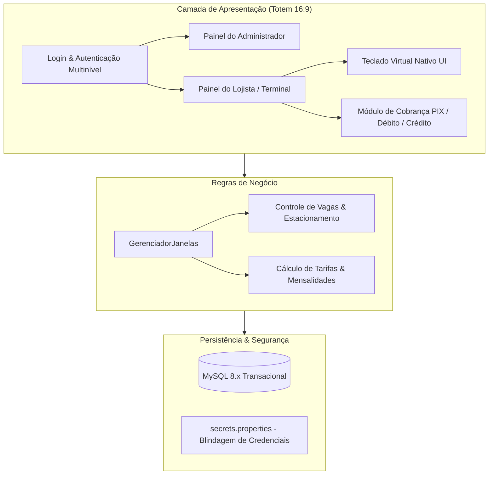

# 🚗 Galpax 26: Sistema Integrado de Gestão Predial & Estacionamento

<p align="left">
  
  
  
  
  <a href="https://github.com/jeronimo-jrsilva"></a>
  
</p>

---

### 📌 1. Visão Geral & Problema de Negócio

O **Galpax 26** é uma aplicação corporativa desenvolvida para automação predial, controle de mensalidades de lojistas e fluxo tarifado de veículos em galpões comerciais e condomínios empresariais de grande porte.

Projetado especificamente para terminais de autoatendimento (**Totens Interativos** em proporção 16:9), o sistema conta com teclado virtual numérico e alfanumérico sob medida, permitindo operação autônoma sem periféricos externos físicos.

Desenvolvido colaborativamente sob **metodologia ágil (Scrum)** pela equipe do curso de Programador de Sistemas no **SENAC Ceará**.

---

### 🏗️ 2. Arquitetura & Decisões Técnicas



#### Destaques de Engenharia:
- **Interface Otimizada para Totens:** Proporção nativa 16:9 com componentes gráficos customizados de alta visibilidade e Teclado Virtual sob medida (`TecladoUI.java` e `TecladoNumericoUI.java`).
- **Segurança e Blindagem de Segredos:** Configuração desacoplada via `secrets.properties` (fora do versionamento Git), protegendo chaves de banco e acessos de produção.
- **Transacionalidade e Integridade:** Scripts DDL e DML robustos ([db/GALPAX_MASTER_INSTALL.sql](db/GALPAX_MASTER_INSTALL.sql)) garantindo consistência relacional entre mensalistas, registros de entrada/saída e relatórios financeiros.

---

### 🛠️ 3. Tecnologias & Componentes

| Módulo | Tecnologia | Propósito |
| :--- | :--- | :--- |
| **Linguagem Principal** | Java SE (JDK 17+) | Lógica de negócio, manipulação de eventos e janelas Swing |
| **Banco de Dados** | MySQL Server 8.x | Armazenamento de dados transacionais e histórico financeiro |
| **Driver de Conexão** | MySQL Connector/J 9.0.0 | Comunicação de alto desempenho via JDBC |
| **Metodologia de Gestão** | Scrum & Git Flow | Divisão de épicos, branches de funcionalidades e code reviews |

---

### 🚀 4. Como Executar Localmente

#### Pré-requisitos:
- Java JDK 17 ou superior (`java -version`).
- MySQL Server 8.x ativo.
- Git.

#### Passo a passo:
```bash
# 1. Clone o repositório
git clone https://github.com/jeronimo-jrsilva/Galpax_26.git
cd Galpax_26

# 2. Configure o banco de dados MySQL
# Execute o script mestre no seu servidor MySQL:
mysql -u root -p < db/GALPAX_MASTER_INSTALL.sql

# 3. Configure as credenciais locais
cp secrets.template.properties secrets.properties
# Edite o arquivo secrets.properties com o seu usuário e senha do MySQL

# 4. Execute a aplicação (via shell script no Linux):
chmod +x run_galpax.sh
./run_galpax.sh
```

*(Ou importe o projeto no Eclipse / IntelliJ IDEA e execute a classe `src/projeto/Login.java`).*

---

### 📂 5. Estrutura do Projeto

```text
Galpax_26/
├── db/
│   └── GALPAX_MASTER_INSTALL.sql   # DDL completo do banco MySQL
├── docs/
│   ├── ARQUITETURA_E_MOCKS.md       # Especificação técnica dos componentes
│   ├── ESQUEMA_BANCO_DADOS.md       # Diagrama de entidades e relacionamentos
│   └── EQUIPE_SENAC.md              # Divisão colaborativa dos módulos
├── lib/
│   └── mysql-connector-j-9.0.0.jar  # Driver JDBC oficial
├── src/
│   ├── imagens/                     # Assets da interface de autoatendimento
│   └── projeto/
│       ├── Login.java               # Tela de acesso inicial e autenticação
│       ├── TecladoUI.java           # Teclado virtual alfanumérico para totens
│       ├── TecladoNumericoUI.java   # Teclado virtual numérico
│       ├── TelaEstacionamento.java  # Gestão de tickets e vagas
│       ├── TelaMensalidade.java     # Gestão financeira de lojistas
│       └── Bancodedados.java        # Pool de conexões JDBC
├── run_galpax.sh                    # Launcher automatizado para Linux
├── secrets.template.properties      # Template seguro de credenciais
└── README.md
```

---

### 👤 Liderança Técnica & Contato

<p align="left">
  <strong>Jeronimo Silva</strong><br>
  <em>Estagiário em Desenvolvimento de Software | Graduando ADS (SENAC Ceará)</em><br>
  Fortaleza - CE | Disponível para Presencial, Híbrido e Remoto
</p>

<p align="left">
  <a href="mailto:jeronimo.aulas@gmail.com"></a>
  <a href="https://linkedin.com/in/jeronimojr-dev" target="_blank"></a>
  <a href="https://github.com/jeronimo-jrsilva"></a>
</p>
